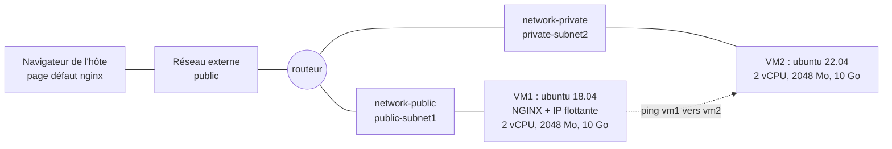

# TP 3 — Infrastructure complète : deux réseaux, un routeur, deux VMs ★★★

## Contexte

Vous devez reproduire, entièrement en Terraform, l'infrastructure du schéma
« Terraform → Infra OpenStack » ci-dessous. Aucune image Ubuntu ni flavor
adapté n'existe dans le cloud : tout est à créer.

## Architecture cible

## Ce que votre code doit créer

1. **Deux réseaux** avec leur sous-réseau :
   - `network-public` / `public-subnet1` (choisissez un CIDR),
   - `network-private` / `private-subnet2` (un autre CIDR).
2. **Un seul routeur** relié au réseau externe `public` ET aux deux
   sous-réseaux — c'est lui qui permet à VM1 de joindre VM2.
3. **Deux images Glance**, créées par Terraform depuis les URLs officielles
   Ubuntu Cloud Images :
   - Ubuntu 18.04 (bionic),
   - Ubuntu 22.04 (jammy).
4. **Un flavor** sur mesure : 2 vCPU, 2048 Mo de RAM, 10 Go de disque
   (le schéma d'origine prévoit 20 Go ; le lab est limité à 30 Go de disque
   hyperviseur pour l'ensemble des instances, d'où 10 Go par VM).
5. **Des security groups adaptés** (un par rôle) :
   - VM1 : HTTP (80), SSH (22) et ICMP entrants,
   - VM2 : ICMP entrant (le ping doit passer) — et SSH si vous voulez
     pouvoir rebondir depuis VM1.
6. **VM1** : Ubuntu 18.04 sur `network-public`, **nginx installé
   automatiquement au premier boot** (page par défaut, pas de page custom),
   **IP flottante** associée.
7. **VM2** : Ubuntu 22.04 sur `network-private`, sans IP flottante.

## Contraintes de structure (imposées)

- Mêmes règles que les TP précédents : fichiers séparés, variables typées
  et documentées, valeurs dans `terraform.tfvars`, préfixe `tp3-` défini
  dans un seul local.
- Le cloud-init de VM1 est un **template externe** (`templates/*.tftpl`)
  rendu par `templatefile()`.
- Les URLs des deux images et les caractéristiques du flavor sont des
  **variables**.

## Sorties attendues

| Output | Contenu |
|--------|---------|
| `vm1_ip_flottante` | l'IP flottante de VM1 |
| `vm1_url` | l'URL http:// de la page nginx |
| `vm1_ip_privee` | l'IP de VM1 sur network-public |
| `vm2_ip_privee` | l'IP de VM2 sur network-private |
| `test_ping` | la commande à lancer depuis VM1 pour pinguer VM2 |

## Critères de validation

- [ ] `terraform validate` passe.
- [ ] `terraform apply` construit toute l'infrastructure en une passe.
- [ ] La page **par défaut de nginx** (« Welcome to nginx! ») s'affiche dans
      le navigateur de l'hôte via l'IP flottante de VM1.
- [ ] Depuis VM1 (SSH), `ping <ip privée de VM2>` répond — la preuve que le
      routage inter-réseaux et les security groups sont corrects.
- [ ] `terraform destroy` remet le cloud à zéro (images et flavor compris).

## Indices 

- Un routeur peut avoir plusieurs interfaces.
- Ubuntu 18.04 est en fin de vie : si l'installation de paquets échoue au
  premier boot, demandez-vous vers quels dépôts pointent les images EOL
  d'Ubuntu (`old-releases`...) et rendez votre cloud-init robuste.
- Sous QEMU émulé, comptez 10 à 25 minutes de boot par VM Ubuntu : lancez
  l'apply puis allez prendre un café. Vérifiez l'avancement avec le journal
  de console dans Horizon.
